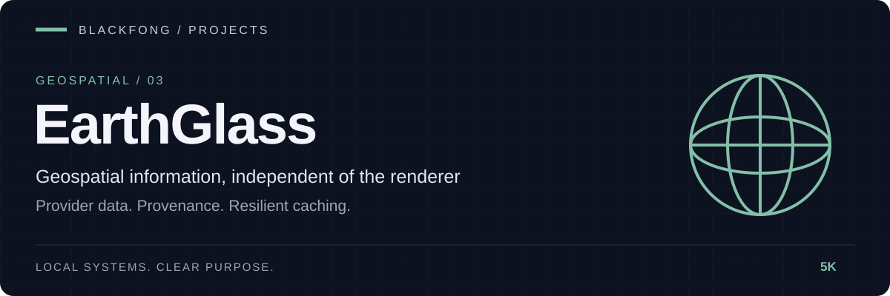

<div align="center">



**Geospatial information, independent of the renderer.**


[](https://github.com/5K-bit/Earthglass/actions/workflows/obeos-component-ci.yml)

[Installation](#installation) · [API](#api) · [CLI](#cli) · [Local system](#run-the-complete-local-system)

</div>

---

# EarthGlass

| Ingest | Preserve | Present |
|---|---|---|
| Provider contracts and normalized GeoJSON | Provenance, cache and freshness metadata | HTTP API, CLI and OBEOS Earth client |

EarthGlass is the **renderer-agnostic geospatial layer engine** for the OBEOS ecosystem. It owns layer definitions, provider contracts, normalized feature payloads, metadata, and caching/refresh behavior. It does **not** own the planetary renderer.

OBEOS Earth is the intended 3D planetary runtime and Cesium client. EarthGlass supplies reusable geospatial information that OBEOS Earth, a CLI, a 2D map, or another client can consume without importing renderer-specific code.

## Architecture

```text
Geospatial providers
  USGS / future feeds
        |
        v
EarthGlass provider adapters
        |
        v
LayerRegistry + LayerDefinition
        |
        +--> FastAPI JSON API
        +--> Typer CLI
        +--> Leaflet demo surface
        +--> OBEOS Earth / Cesium client
```

The repository now contains two deliberately separated packages:

- `earthglass/` — Python ingestion, validation, cache, lifecycle, CLI, and HTTP API
- `obeos-earth/` — React/TypeScript/Cesium planetary client consuming that API

The legacy Leaflet page remains a lightweight development surface. Leaflet and Cesium are not part of the EarthGlass core model.

## Current milestone

Version 0.4 connects the first provider slice to the planetary client:

- renderer-independent `LayerDefinition`
- central `LayerRegistry`
- provider manager and observable lifecycle state
- live USGS all-day earthquake retrieval
- validated, normalized GeoJSON features
- collection- and feature-level source provenance
- atomic persistent cache with explicit fresh/stale metadata
- degraded operation from the last valid cache
- FastAPI and CLI consuming the same core registry
- feature, refresh, and provider-status API endpoints
- tests enforcing that serialized layer definitions do not depend on Leaflet or Cesium
- separate Cesium globe with bundled Natural Earth imagery and no Ion token requirement
- magnitude-scaled earthquake markers, event details, camera flight, attribution, and status
- five-minute background refresh plus explicit refresh controls
- CORS restricted to the local OBEOS Earth development/preview origins by default

## Layout

```text
earthglass/
  earthglass/
    __init__.py
    layers.py          # layer model + registry
    providers.py       # validated contracts + provider manager
    cache.py           # persistent normalized-feature cache
    usgs.py            # live earthquake adapter
    runtime.py         # default provider composition
    cli.py             # Typer adapter
    web/
      app.py           # FastAPI adapter + demo UI
      templates/
      static/
  tests/
    test_layers.py
    test_web.py
    test_cli.py
  pyproject.toml
  obeos-earth/
    src/api.ts        # typed EarthGlass HTTP client
    src/App.tsx       # Cesium world presentation
    src/api.test.ts   # client contract tests
    vite.config.ts    # Cesium runtime assets
  README.md
```

## Installation

```bash
python -m pip install -e ".[dev]"
```

## API

- `GET /health`
- `GET /api/status`
- `GET /api/layers`
- `GET /api/layers/{layer_id}`
- `GET /api/layers/{layer_id}/features`
- `POST /api/layers/{layer_id}/refresh`
- `GET /api/providers/status`
- `GET /` — optional Leaflet demo surface

Run locally:

```bash
earthglass serve
earthglass serve --reload
```

## CLI

```bash
earthglass --help
earthglass layers
earthglass cache status
earthglass refresh earthquakes
```

By default, provider data is cached under `.earthglass-cache/`. Set
`EARTHGLASS_CACHE_DIR` to choose another location. When USGS cannot be reached,
EarthGlass returns the last validated cache with `metadata.cache.stale: true` and
reports the provider as `degraded`. Without a valid cache, the feature API returns
HTTP 503; stale external data is never represented as live.

## Development

```bash
pytest
```

## Run the complete local system

Requirements: Python 3.11+, Node.js 22+, and pnpm.

Install once:

```powershell
python -m venv .venv
.\.venv\Scripts\python.exe -m pip install -e ".[dev]"
pnpm --dir obeos-earth install
```

Start the EarthGlass API in the first terminal:

```powershell
.\.venv\Scripts\earthglass.exe serve --host 127.0.0.1 --port 8000
```

Start OBEOS Earth in the second terminal:

```powershell
pnpm --dir obeos-earth dev
```

Open `http://127.0.0.1:5173/`. The client reads
`http://127.0.0.1:8000/api/layers/earthquakes/features` by default. Override
the API before building or starting the client when needed:

```powershell
$env:VITE_EARTHGLASS_API_BASE="https://earthglass.example/api"
```

Frontend verification:

```powershell
pnpm --dir obeos-earth test
pnpm --dir obeos-earth build
```

## What works today

**Implemented and tested**

- USGS earthquake provider: validated normalization, per-feature provenance, atomic disk cache.
- Fresh / stale / unavailable reporting through the API (`docs/FRESHNESS.md`), replayable offline with `tools/freshness_demo.py`.
- Single-flight refresh under concurrent requests; fresh data kept when the cache write fails.
- FastAPI and CLI over the same registry; OBEOS Earth client tests (`pnpm --dir obeos-earth test`).

**Known limitations**

- Freshness replay covers the earthquake provider only; see "Remaining limits" in `docs/FRESHNESS.md`.
- Provider `state` stays `ready` for an aged cache until a request refreshes it.
- No automated browser test of the globe.

**Planned**

- Screenshots of the client in each freshness state.

## Quick start (no network needed)

Prerequisites: Python 3.11+.

```bash
python -m venv .venv && . .venv/bin/activate
python -m pip install -e ".[dev]"
python -m pytest -q
python tools/freshness_demo.py
```

Expected: pytest ends with `137 passed, 2 skipped`; the demo prints an 8-row table whose rows 3-5 read `cache | True` with provider `degraded`, and rows 7-8 read `503`.

Troubleshooting: if `pytest` fails during collection with a missing `PIL`, install the `dev` extra (`pip install -e ".[dev]"`). If the demo cannot bind a port, it picks a free one; check for a local firewall blocking `127.0.0.1`.

## Architecture in brief

A provider adapter fetches and validates upstream data into `NormalizedFeature`s, the `FeatureCache` persists the last valid collection, and the provider decides per request whether to serve live, fresh-cached, stale-cached or fail. FastAPI and the CLI are thin adapters over that decision; the Cesium client only consumes the JSON.

## Ownership

- **Problem:** a map that silently shows old data as current is worse than one that says it is unavailable.
- **Evidence:** the existing tests already covered live, fresh-cache, stale-cache, no-cache, corrupt-cache and concurrent refresh at the provider level. Replaying them through the real HTTP API on a fixed dataset showed the status endpoint reporting a 3-hour-old cache as not stale.
- **Decision:** keep "never represent stale data as live" as the rule; fix the status endpoint; leave the broader `state` semantics open.
- **Implementation:** `earthglass/usgs.py` (status), `tools/freshness_demo.py`, `docs/FRESHNESS.md`.
- **Verification:** `tests/test_usgs_provider.py::test_status_reports_aged_cache_as_stale_without_a_request` (fails without the fix); CI run linked from the pull request.
- **Remaining limits:** see `docs/FRESHNESS.md`.

## Development practice

AI tools assist with implementation, debugging, tests, and documentation.
Louis Boddie owns project direction and acceptance decisions; linked tests and release evidence document what has been verified.

## Relationship to OBEOS Earth

**EarthGlass understands geospatial information. OBEOS Earth understands the planet.**

EarthGlass remains usable without Cesium, React, or the OBEOS Earth frontend. OBEOS Earth consumes only the public EarthGlass API and translates normalized observations into Cesium entities. Cesium imports and renderer state remain confined to `obeos-earth/`.

## Terminal identity

`earthglass --version` prints the installed version (source version when running an uninstalled checkout). Help identifies EarthGlass as a Blackfong project. Interactive commands display a compact product banner on stderr; automatic banners are suppressed when either output stream is redirected. Use `--no-banner` to suppress it or `--banner` before a subcommand to request it explicitly. `NO_COLOR` and `TERM=dumb` disable banner colors. Command output, exit codes, and operational status labels retain their meaning.
